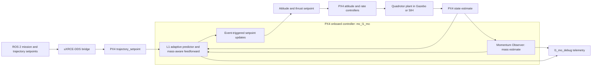

# Adaptive Payload-Aware Control for Quadrotor Logistics

**Undergraduate thesis project · Engineering Physics, Institut Teknologi Bandung · 2026**  
**Author:** Nabil Karim Abdurrahman

## Project Overview

This project develops and validates an onboard flight-control system for quadrotors that pick up and release payloads during multi-stop logistics missions. A payload change creates an abrupt shift in vehicle mass and thrust demand. A fixed-gain cascaded PID controller can respond with a large altitude transient and a slow recovery.

The proposed PX4 module, `mc_l1_mo`, combines **L1 Adaptive Control**, a **Momentum Observer (MO)** for real-time mass estimation, and **Event-Triggered Control (ETC)**. The design targets the resource-constrained Pixhawk 2.4.8 (FMUv3, STM32F427) and runs onboard without a companion computer in the control loop.

MATLAB was used for 6-DOF plant modeling, controller design, sensitivity studies, and parameter tuning. The final performance comparisons and reported campaign data come from PX4 Software-in-the-Loop using ROS 2 and Gazebo Harmonic, followed by onboard timing and memory validation through PX4 Simulation-in-Hardware.

## Control Design

At each 100 Hz control cycle, the observer uses the vehicle's vertical momentum and thrust model to estimate mass. That estimate feeds the L1 state predictor and thrust feedforward continuously. L1 adaptation compensates for residual model uncertainty and disturbances, while a low-pass filter shapes the adaptive control signal. ETC holds the previous attitude/thrust command while changes remain below configured thresholds and publishes an updated command when the vehicle needs a correction. The controller calculation still runs every cycle; ETC reduces setpoint update traffic rather than control-computation load.

## My Contributions

- Built a coupled 6-DOF MATLAB model of the quadrotor, payload-mass transitions, disturbances, and L1+MO+ETC control.
- Tuned controller parameters using multi-objective optimization and sensitivity studies, balancing tracking, mass-estimation accuracy, and control effort.
- Implemented `mc_l1_mo` as a native PX4 `ScheduledWorkItem`, using uORB state and trajectory topics and publishing attitude setpoints and debug telemetry.
- Integrated the controller into ROS 2 and PX4 simulation workflows using uXRCE-DDS and Gazebo.
- Designed repeatable hover, single-drop, multi-drop, pickup-and-drop, and wind scenarios. Compared the proposed design with the PX4 cascaded PID baseline and ran ablation studies for the mass observer and horizontal integrator.
- Validated onboard timing and memory use on Pixhawk hardware through PX4 Simulation-in-Hardware (SIH).

## Validation and Results

| Measure | Result | Validation context |
|---|---:|---|
| Peak altitude error during payload transitions | 38–41% lower than the PID baseline | ROS 2 and PX4 SITL with Gazebo Harmonic |
| Recovery time after a mass transition | 2.2–2.6× faster than the PID baseline | ROS 2 and PX4 SITL with Gazebo Harmonic |
| Payload mass estimation error | Approximately 2–3% | ROS 2/PX4 payload-change scenarios |
| Controller computation time | 23 μs minimum per cycle | Pixhawk 2.4.8 SIH, controller calculation |
| Complete module `Run()` time | 45 μs minimum per cycle | Pixhawk 2.4.8 SIH, including uORB I/O |
| SRAM use | 15.71% | FMUv3 target |
| Flash use | 97.66% | FMUv3 target |

Validation progressed from MATLAB algorithm studies to final Software-in-the-Loop campaigns with ROS 2 and Gazebo Harmonic, then to PX4 SIH on the target flight controller. SIH measured embedded execution on the Pixhawk processor; it does not represent a real outdoor flight test. Real-flight validation is a next step.

## Tools and Technologies

- **Modeling and control design:** MATLAB, Simulink
- **Optimization:** Global Optimization Toolbox (`gamultiobj` / NSGA-II), sensitivity analysis
- **Flight-control firmware:** PX4 v1.17, C++, NuttX, uORB
- **Robotics and communication:** ROS 2, uXRCE-DDS, Micro XRCE-DDS Agent
- **Final simulation and embedded validation:** Gazebo Harmonic, PX4 SITL, PX4 SIH
- **Target hardware:** Pixhawk 2.4.8, FMUv3, STM32F427
- **Data analysis:** Python and MATLAB

## Project Materials

- [PX4 firmware module and integration patch](firmware/)
- [ROS 2 offboard and SITL campaign scripts](ros2/sitl-campaign/)
- [Gazebo payload models and worlds](simulation/gazebo/)
- [uXRCE-DDS middleware dependency](middleware/README.md)
- [Final ROS 2/PX4 SITL metrics and selected plots](data/final-sitl/)
- [MATLAB model, optimization outputs, and supporting figures](program/)
- [Thesis summary](docs/RINGKASAN_SKRIPSI.md)

This portfolio includes the project-specific PX4 overlay, ROS 2 campaign source, Gazebo payload assets, and curated final analysis. It does not duplicate the full upstream PX4 checkout, middleware source, generated build products, or the complete raw time-series archive.

